# LinBI

Clone **educativo** di Power BI Desktop per Linux: stessa struttura dell'interfaccia
(ribbon, viste Report/Tabella/Modello, riquadri Filtri · Visualizzazioni · Dati) e
stesso flusso di lavoro (Ottieni dati → Strumento di navigazione → trascina i campi → report).

Non è affiliato a Microsoft; nome e logo sono volutamente diversi.

## Screenshot

| | |
|---|---|
| 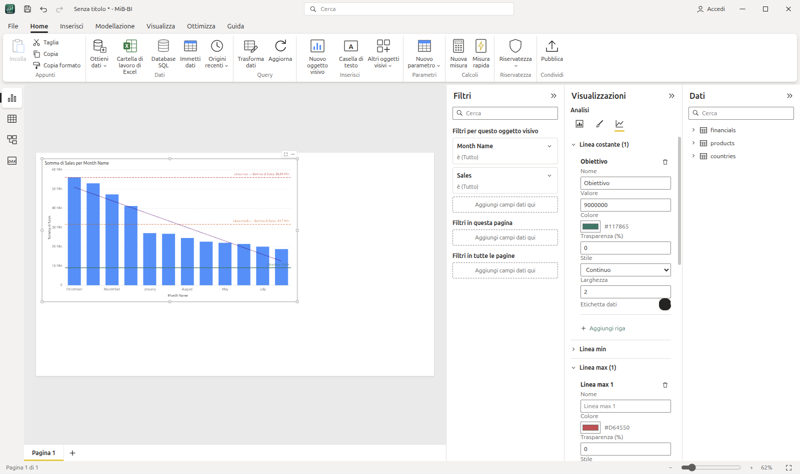 | 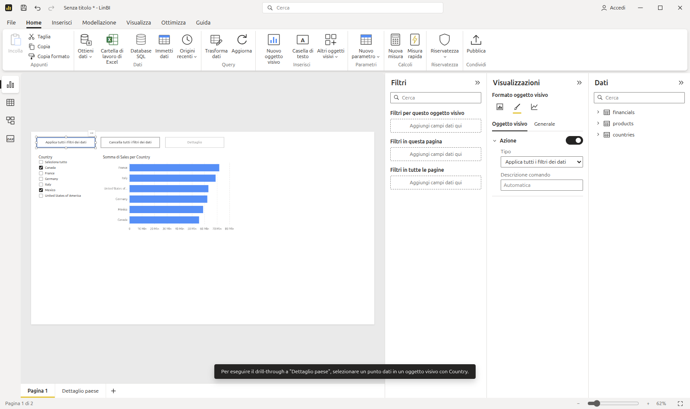 |
| **Riquadro Analisi** — linee costante, min, max, media, mediana, percentile e di tendenza | **Pulsanti** — Applica / Cancella tutti i filtri dei dati, drill-through, scheda Azione |
| 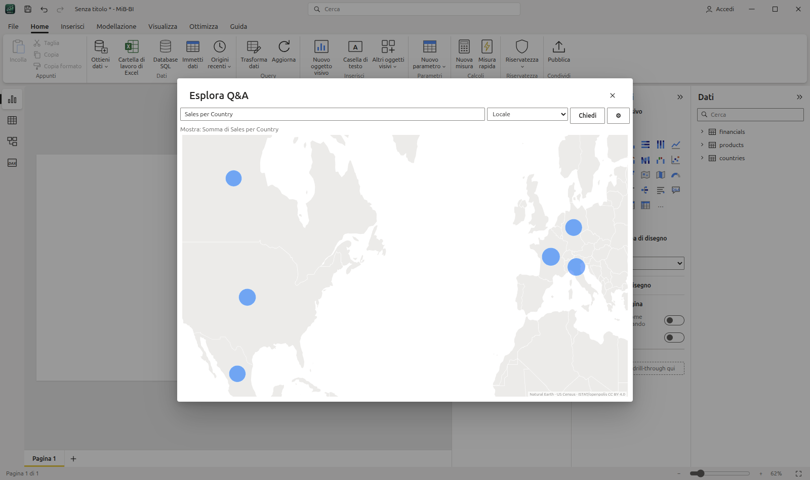 | 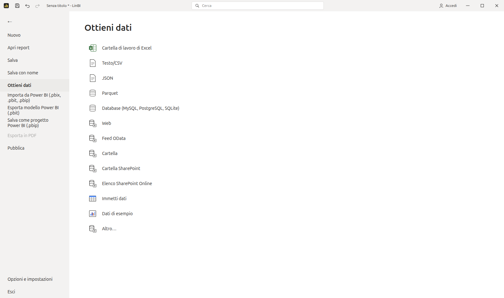 |
| **Esplora Q&A** — aperto da un pulsante con azione Q&A | **File › Ottieni dati** — tutte le origini dal menu File |
| 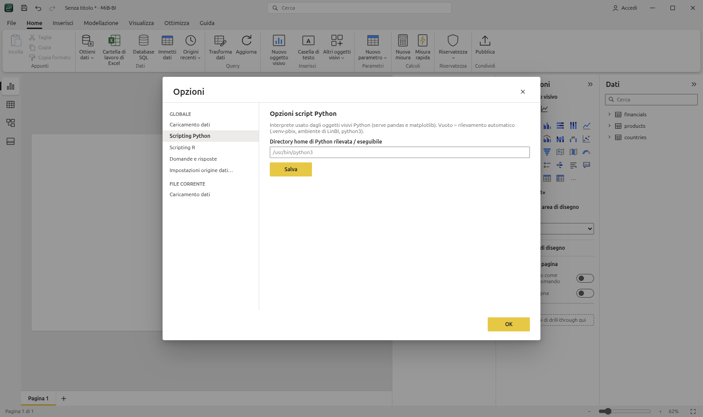 | 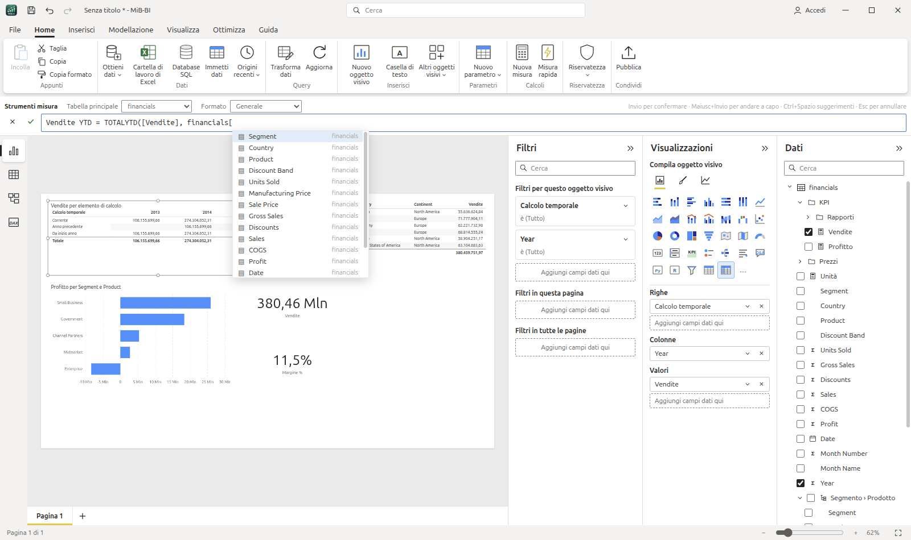 |
| **Opzioni e impostazioni** — caricamento dati, script Python/R, Q&A, Data/ora automatica | **Modello e DAX** — IntelliSense nella barra della formula, cartelle di visualizzazione, gerarchie utente, gruppo di calcolo in una matrice |
| 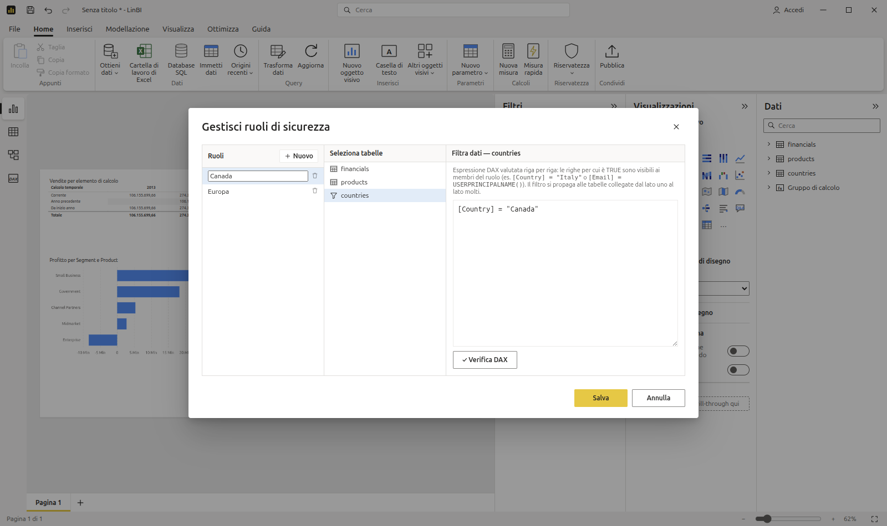 | 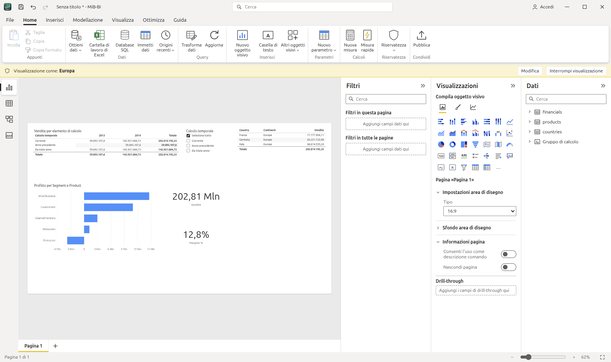 |
| **Gestisci ruoli** — sicurezza a livello di riga con filtri DAX per tabella | **Visualizza come** — il report visto dal ruolo *Europa* (barra gialla, filtro propagato ai fatti) |
| 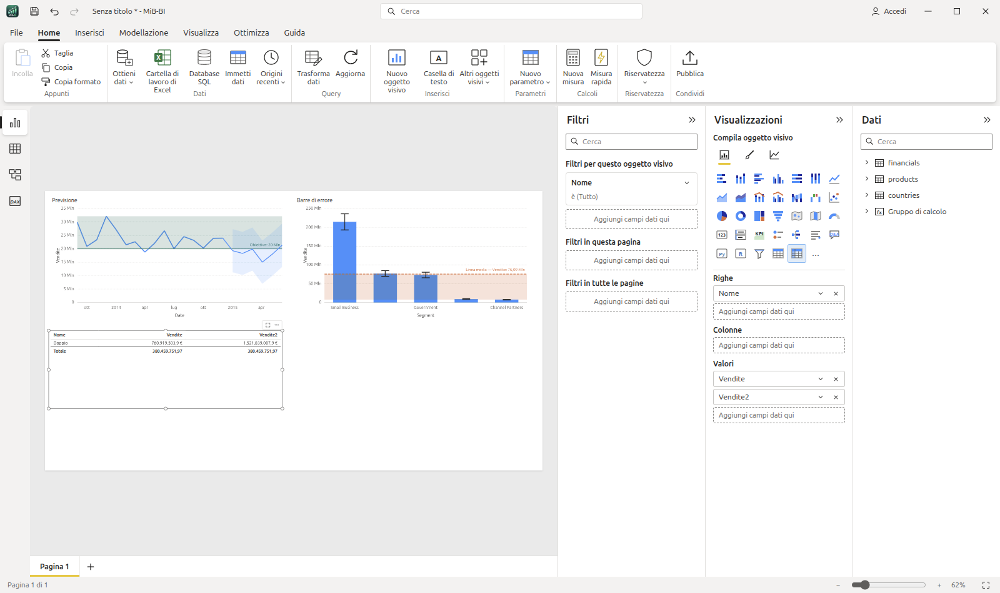 | 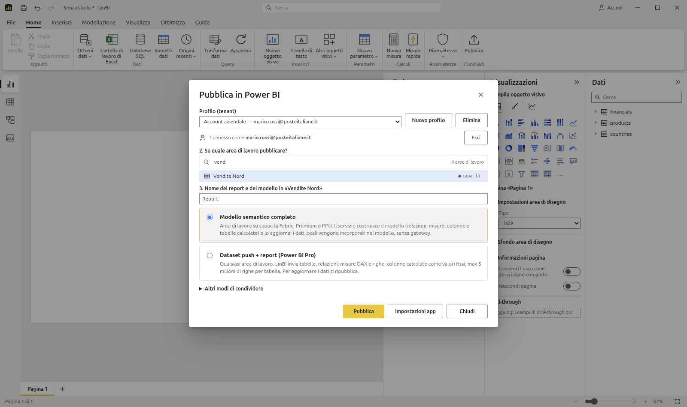 |
| **Analisi** — previsione con intervallo di confidenza, area ombreggiata, barre di errore da campi, formato dinamico di un elemento di calcolo | **Pubblica** — accesso con l'account aziendale, ricerca tra tutte le aree di lavoro, scelta della destinazione |
| 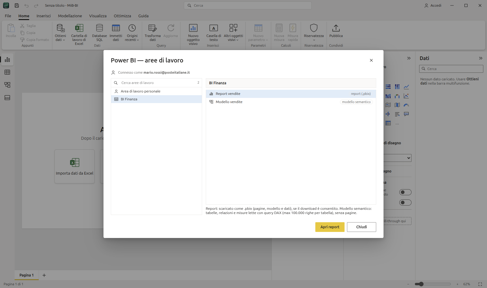 | |
| **Ottieni dati › Power BI** — report (.pbix) e modelli semantici delle proprie aree di lavoro | |

## Scaricare e installare

Dalla pagina [Releases](https://github.com/mbulloni/LinBI/releases) (Linux x64):

```bash
# AppImage (qualsiasi distribuzione)
chmod +x LinBI-1.2.1.AppImage && ./LinBI-1.2.1.AppImage

# oppure pacchetto Debian/Ubuntu (voce di menu e associazioni file incluse)
sudo apt install ./linbi_1.2.1_amd64.deb
```

Per aprire i file `.pbix` di Power BI serve Python 3 con la libreria `pbixray` (una volta sola):

```bash
sudo apt install python3-venv     # se manca il modulo venv
python3 -m venv ~/.config/linbi/pbix-venv
~/.config/linbi/pbix-venv/bin/pip install pbixray pyarrow
```

LinBI usa da solo questo ambiente. I file `.pbit`, `.pbip`, `.lbix` e tutte le altre origini non richiedono Python.
La prima volta che si usano Excel o un database, DuckDB scarica la relativa estensione (serve la rete).

## Sviluppo

```bash
npm install
npm run setup:pbix                      # opzionale: lettura dei file .pbix (Python + pbixray)
node node_modules/electron/install.js   # solo se npm ha bloccato lo script di Electron
npm run dev      # Vite + Electron con hot reload
npm start        # build di produzione + Electron
npm run dist     # AppImage in release/ (npm run dist:deb per il .deb)
```

### Installazione (utente, senza root)

```bash
install -m 755 release/LinBI-1.2.1.AppImage ~/Applications/LinBI.AppImage
ln -sf ~/Applications/LinBI.AppImage ~/.local/bin/linbi
# icone in ~/.local/share/icons/hicolor/*/apps/linbi.png (da build/icons), voce di menu
# ~/.local/share/applications/linbi.desktop (Exec=…/LinBI.AppImage %f) e tipi MIME .lbix/.pbix/.pbit/.pbip
python3 -m venv ~/.config/linbi/pbix-venv && ~/.config/linbi/pbix-venv/bin/pip install pbixray pyarrow   # apertura .pbix
```

`linbi report.lbix` (o doppio clic su un file associato) apre il report all'avvio.

## Architettura

| Power BI          | LinBI                                                         |
|-------------------|---------------------------------------------------------------|
| VertiPaq          | DuckDB in-memory (`electron/db.cjs`)                           |
| Query DAX dei visual | SQL generato da `src/query.ts` (GROUP BY + filtri)          |
| Visual            | Apache ECharts + componenti React (`src/visuals/`)             |
| File .pbix        | `.lbix`: zip con `report.json` (report, origini, passaggi, DAX) e un Parquet per tabella |

Flusso: `Data pane` → drag/checkbox → `store.addField` (posizionamento automatico nei
contenitori) → `buildVisualQuery` → IPC `db:query` → render.

Filtri applicati a ogni visual: report → pagina → visual → filtri dei dati (slicer) → filtro
incrociato (click su barra/fetta/riga).

### Relazioni e semantica delle query (fase 3)

- Relazioni normalizzate come in Power BI: `from` = lato molti, `to` = lato uno; cardinalità `*:1`, `1:1`, `*:*`; direzione filtro *Singola* / *Entrambe*; attiva / inattiva.
- Ogni misura viene valutata sulla **propria tabella** (base); dimensioni e filtri vengono uniti con `LEFT JOIN` lungo il percorso più breve di relazioni attive.
- Il filtro scorre dal lato uno al lato molti; al contrario solo con direzione *Entrambe* (o `1:1`, `*:*`). Un filtro su una tabella non raggiungibile viene ignorato, come in Power BI.
- Se il percorso attraversa un salto uno→molti, la base viene deduplicata (`DISTINCT rowid`) per non contare due volte le righe.
- Misure di tabelle diverse nello stesso visual: una sottoquery per tabella, allineate con `FULL JOIN … IS NOT DISTINCT FROM`.
- Rilevamento automatico all'importazione: stesso nome di colonna, tipo compatibile, valori univoci su un lato; i percorsi ambigui vengono creati inattivi.

### Power Query (fase 4)

**Home › Trasforma dati** (o *Trasforma dati* nello Strumento di navigazione, o *Modifica query* nel riquadro Dati) apre
l'**Editor di Power Query**: elenco query, griglia di anteprima (prime 1000 righe, qualità colonna), barra della formula
con il codice M del passaggio selezionato, *Impostazioni query* con i **passaggi applicati** (selezionabili ed eliminabili).

| Gruppo | Trasformazioni |
|---|---|
| Colonne | Scegli colonne, Rimuovi colonne / altre colonne, Rinomina (doppio clic sull'intestazione), Duplica, Tipo di dati |
| Righe | Filtro con elenco valori e filtri per testo/numero/data, Rimuovi vuoti, Mantieni/Rimuovi prime o ultime righe, Rimuovi duplicati, Ordinamento |
| Trasforma | Sostituisci valori, Riempi in basso/in alto, Dividi colonna per delimitatore, Formato (maiuscolo, minuscolo, iniziali maiuscole, taglia, lunghezza), Arrotonda, Valore assoluto, Anno/Trimestre/Mese/Giorno, Trasforma (altre) colonne in valori (unpivot), Raggruppa per |
| Aggiungi colonna | Colonna personalizzata (formula M: `[Col]`, aritmetica, `&`, `if … then … else`, `Text.*`, `Number.*`, `Date.*`), Colonna indice |
| Combina | Unisci query (join esterno sx/dx/completo, interno, anti), Accoda query, Duplica / Riferimento query, Nuova origine |

Ogni passaggio è salvato nella tabella (`steps`, anche nel `.lbix`) e compilato da `src/pq/compile.ts` in una
**pipeline SQL**: una CTE per passaggio, con una colonna nascosta `__r` che conserva l'ordine delle righe come fa
Power Query. Le query referenziate (Riferimento, Unisci, Accoda) vengono incorporate come sottoquery, quindi le bozze
dell'editor si vedono a vicenda prima di *Chiudi e applica*. Lo stesso elenco di passaggi genera il codice M
(`src/pq/m.ts`) mostrato nella barra della formula e nell'*Editor avanzato* ed esportato nel `.pbit`.
*Visualizza › SQL generato* mostra la query DuckDB equivalente: utile per confrontare M e SQL.

Rinominare una query rinomina la tabella anche nel report (campi, filtri, relazioni, misure); rinominare una
colonna con un passaggio non aggiorna gli oggetti visivi che la usano, come in Power BI.
Differenze note: *Modifica tipo* usa `TRY_CAST` (i valori non convertibili diventano `null` invece di *Error*);
l'Editor avanzato è in sola lettura; i passaggi si eliminano ma non si modificano (rifarli dopo averli eliminati).

### DAX (fase 5)

Motore in `src/dax/` (`parse.ts` lexer/parser, `engine.ts` compilatore DAX → SQL). Il **contesto di filtro** è
esplicito: un elenco di filtri, ciascuno un predicato SQL sulle righe di una tabella. Un'aggregazione su una tabella
diventa una sottoquery correlata che applica tutti i filtri, quelli delle altre tabelle tramite *semi-join* lungo le
relazioni attive nella direzione consentita (uno → molti, o entrambe). Da qui la semantica di Power BI:

- **CALCULATE / CALCULATETABLE**: transizione di contesto (righe → filtri), poi `ALL`/`REMOVEFILTERS`/`ALLEXCEPT`/
  `ALLSELECTED` rimuovono filtri, gli argomenti filtro **sostituiscono** quelli sulle stesse colonne (`KEEPFILTERS` li
  interseca), `USERELATIONSHIP` e `CROSSFILTER` cambiano le relazioni. I filtri di tabella seguono le *tabelle espanse*
  (un filtro su `Sales` filtra anche `Product`).
- **Iteratori**: `SUMX`, `AVERAGEX`, `MINX`, `MAXX`, `COUNTX`, `PRODUCTX`, `CONCATENATEX`, `RANKX`, `FILTER`, `ADDCOLUMNS`,
  `SELECTCOLUMNS`, `TOPN`, `SUMMARIZE`, `SUMMARIZECOLUMNS`; una misura dentro un iteratore applica la transizione di contesto.
- **Time intelligence**: `TOTALYTD/QTD/MTD`, `DATESYTD/QTD/MTD`, `SAMEPERIODLASTYEAR`, `DATEADD`, `PARALLELPERIOD`,
  `PREVIOUS*`/`NEXT*`, `DATESBETWEEN`, `DATESINPERIOD`, `FIRSTDATE`/`LASTDATE`, `STARTOF*`/`ENDOF*`.
- Altro: `VAR … RETURN`, `SWITCH`, `SELECTEDVALUE`, `HASONEVALUE`, `ISFILTERED`, `ISINSCOPE`, `RELATED`, `RELATEDTABLE`,
  `LOOKUPVALUE`, `EARLIER`, `TREATAS`, `CALENDAR`, `CALENDARAUTO`, `FORMAT` (formati italiani), funzioni matematiche,
  di testo e di data. Misure su più tabelle senza limitazioni.

Ogni valore (VAR, misura usata più volte nello stesso contesto) viene calcolato una sola volta tramite tabelle derivate:
senza questo, l'SQL di misure annidate cresce in modo esponenziale.

**Nuova misura / Nuova colonna / Nuova tabella** (Home, Modellazione, menu del riquadro Dati) aprono la barra della
formula: `Nome = espressione`, Invio per confermare. Le colonne calcolate (contesto di riga della tabella) e le tabelle
calcolate vengono ricalcolate dopo ogni caricamento ed esportate nel `.pbit` come oggetti calcolati.
La **Vista query DAX** esegue `DEFINE MEASURE … / VAR …`, `EVALUATE …`, `ORDER BY`, con esempi generati dal modello
e l'SQL DuckDB di ogni query. Clic su un campo del riquadro Dati per inserirlo.

Verificato sulle misure dei sample Microsoft *Retail Analysis* (32/32) e *Sales & Returns* (58/58).
Differenze note: senza una tabella contrassegnata come tabella delle date, le funzioni di time intelligence considerano
"attributi di calendario" le colonne data/anno/mese/… della stessa tabella (o tutta la tabella se il nome ricorda un calendario);
i confronti di testo distinguono maiuscole/minuscole; `TOPN` non include i pari merito; `SUMMARIZECOLUMNS` con colonne
di tabelle diverse fa il prodotto cartesiano dei valori e scarta le righe con tutte le espressioni vuote.

### Modello e DAX (fase 10)

- **IntelliSense** nella barra della formula, nella Vista query DAX e in Gestisci ruoli: funzioni (con firma e descrizione),
  tabelle dopo `'`, colonne e misure dopo `[` (le colonne della tabella scritta prima della parentesi), parole chiave;
  ↑/↓ per scegliere, Tab o Invio per inserire, Ctrl+Spazio per riaprire. Mentre si scrivono gli argomenti compare la firma
  della funzione con l'argomento corrente in grassetto.
- **Gerarchie utente**: clic destro su una colonna › *Crea gerarchia* / *Aggiungi alla gerarchia*; nel riquadro Dati la gerarchia
  si espande nei livelli e trascinata su un asse inserisce tutti i livelli (drill-down). *Proprietà* rinomina, riordina e
  rimuove i livelli.
- **Cartelle di visualizzazione** per misure, colonne e gerarchie (*Proprietà › Cartella di visualizzazione*, `\` per le
  sottocartelle).
- **Contrassegna come tabella delle date** (menu della tabella): verifica che la colonna abbia date univoche, senza vuoti e
  contigue; le funzioni di time intelligence sostituiscono i filtri su tutta la tabella delle date, che non riceve la
  gerarchia automatica di Data/ora automatica.
- **Gruppi di calcolo** (Modellazione › Gruppo di calcolo): elementi con `SELECTEDMEASURE()`, `SELECTEDMEASURENAME()`,
  `ISSELECTEDMEASURE()`, precedenza tra gruppi; l'elemento filtrato (filtro dei dati, righe/colonne di una matrice,
  CALCULATE) sostituisce la misura. La colonna del gruppo si incrocia con i campi delle altre tabelle come in
  `SUMMARIZECOLUMNS`.
- **Sicurezza a livello di riga** (Modellazione › Gestisci ruoli): un filtro DAX per tabella, verifica della sintassi; il
  filtro si propaga dal lato uno al lato molti. **Visualizza come**: uno o più ruoli (unione delle righe) e *Altro utente* per
  `USERPRINCIPALNAME()`. Le tabelle filtrate vengono copiate in uno schema DuckDB separato letto da una seconda connessione,
  così nessuna misura (nemmeno con `ALL`) vede righe escluse dal ruolo.
- Tutto viene salvato nel `.lbix`, importato da `.pbix`/`.pbit`/`.pbip` (TMSL e TMDL) ed esportato nel modello
  (`hierarchies`, `displayFolder`, `dataCategory: Time` + `isKey`, `calculationGroup`, `roles`).

- Gli elementi di calcolo trasformano anche le misure richiamate dentro altre misure e dentro altri elementi, come in
  Power BI (una misura non viene ritrasformata dallo stesso gruppo); la *stringa di formato dinamica*
  (`formatStringDefinition`) si applica cella per cella in tabelle, matrici e schede. Con un gruppo di calcolo le
  colonne non vengono più aggregate (misure implicite disattivate).
- Gerarchie: nomi dei livelli modificabili, i campi di una gerarchia negli oggetti visivi sono esportati come
  `HierarchyLevel`; gerarchie e misure compaiono anche nelle tabelle della vista modello (clic destro › Proprietà).
- RLS: *Applica filtro di sicurezza in entrambe le direzioni* nella relazione (`securityFilteringBehavior`);
  *Visualizza come* vale anche per la Vista tabella e la Vista query DAX.
- Opzioni › **Impostazioni internazionali**: lingua di numeri e date (anche nomi di mesi/giorni e "Trim"/"Qtr" della
  gerarchia date, cultura del modello esportato) e **separatori DAX locali** (`;` e `,` decimale) nella barra della
  formula, nella Vista query DAX e nei ruoli (salvati sempre con i separatori standard).
- IntelliSense suggerisce anche le variabili `VAR` già dichiarate.

Limiti noti: i dataset push non supportano ruoli, gruppi di calcolo e gerarchie (limite delle API Power BI); delle barre di
errore e della previsione i file Power BI conservano solo aspetto e attivazione (tipo, limiti da campi, lunghezza e
confidenza restano nel `.lbix`), perché i nomi di quelle proprietà non sono documentati nello schema ufficiale.

## File Power BI

| Operazione | Supporto |
|---|---|
| **Aprire `.pbix`** | Sì: tabelle con dati, relazioni, misure DAX, query M, "ordina per colonna", pagine, visual, filtri, slicer, immagini e sfondi. Il modello VertiPaq (compresso XPress9) è decodificato da [pbixray](https://github.com/Hugoberry/pbixray) in `electron/pbix/read_pbix.py` ed esportato in Parquet per DuckDB. |
| **Aprire `.pbit`** | Sì: schema, misure, relazioni e report. I dati vengono ricaricati se la query M punta a un file locale, altrimenti le tabelle restano vuote. |
| **Aprire `.pbip`** | Sì (progetto Power BI, cartelle di testo): report legacy (`report.json`) o **PBIR** (`definition/pages/…/visual.json`), modello TMSL (`model.bim`) o **TMDL** (`definition/*.tmdl`), colonne e tabelle calcolate. I dati vengono caricati dalle query M che puntano a file locali. Lettore in `electron/pbip.cjs`, conversione PBIR → layout in `src/pbix/pbir.ts`. |
| **Aprire `.pbix` PBIR** | Sì: i report salvati nel nuovo formato PBIR dentro il `.pbix` vengono convertiti come sopra. |
| **Salvare `.pbip`** | Sì (File › Salva come progetto Power BI): `X.pbip`, `X.Report/report.json`, `X.SemanticModel/model.bim`, risorse e tema; file di testo adatti a git. |
| **Salvare `.pbit`** | Sì (File › Esporta modello Power BI): modello TOM, query M per ogni tabella, misure, relazioni, layout e immagini. Power BI Desktop ricarica i dati dalle origini, poi si salva come `.pbix`. |
| **Salvare `.pbix`** | No: richiederebbe la scrittura del backup di Analysis Services con colonne VertiPaq e compressione XPress9 proprietaria; non esiste un writer open source. |

Limiti dell'import: i tipi di visual sconosciuti (né standard né `.pbiviz` incorporato nel file) diventano segnaposto;
i report in connessione dinamica (Power BI Service/SSAS) non contengono dati: si aprono da *Ottieni dati › Power BI*.
Le misure DAX importate passano dal motore della fase 5; una funzione non supportata mostra un messaggio esplicito nel visual.

### File, temi e PDF (fase 6)

- **Salva** produce un `.lbix` con i **dati incorporati** (Parquet compresso zstd, come i dati dentro un `.pbix`): il
  report si riapre anche senza le origini; *Aggiorna* ricarica dalle origini originali. I vecchi `.lbix` JSON si aprono ancora.
- **Temi** (Visualizza › Temi): galleria di temi incorporati, *Sfoglia temi…* per importare un file JSON di tema Power BI
  (`name`, `dataColors`, `background`, `foreground`, `tableAccent`), *Salva tema corrente*. Il tema colora grafici e
  sfondi, viene salvato nel report, esportato nel `.pbit`/`.pbip` come tema personalizzato e letto dai file Power BI.
- **Esporta in PDF** (File): una pagina PDF 1280×720 per ogni pagina del report, con i filtri di ciascuna pagina.

### Connessioni a database

**Home › Database SQL** (o *Ottieni dati › Database*): MySQL/MariaDB, PostgreSQL e SQLite tramite le estensioni di
DuckDB (`ATTACH … READ_ONLY`, scaricate al primo uso). Modalità *Importa*: lo Strumento di navigazione elenca tabelle
e viste con anteprima; *Carica* o *Trasforma dati* (Power Query). *Aggiorna* rilegge dal database. Le password non
finiscono mai nel report: sono cifrate con il portachiavi di sistema (Electron `safeStorage`) in
`~/.config/linbi/credentials.json`, oppure tenute solo per la sessione. Nel `.pbit` diventano `MySQL.Database` /
`PostgreSQL.Database`. SQL Server non è disponibile (DuckDB non ha un connettore).

### Pubblica

**Pubblica** invia il report al servizio Power BI con le API REST, senza Power BI Desktop
(`electron/powerbi.cjs`). Il flusso è quello di Power BI Desktop: **1.** si inserisce l'e-mail aziendale e si
accede nella pagina Microsoft della propria organizzazione (browser di sistema, codice di autorizzazione + PKCE con
reindirizzamento su `http://localhost`; il tenant viene ricavato dal dominio dell'e-mail; in alternativa il codice
dispositivo); **2.** LinBI cerca **tutte** le aree di lavoro dell'account (con casella di ricerca; quelle in sola
lettura non sono selezionabili); **3.** si sceglie l'area di lavoro e il nome, poi *Pubblica*.

*Accedi* (barra del titolo, Pubblica, Ottieni dati › Power BI) chiede sempre per prima l'e-mail aziendale. Se LinBI non
è ancora autorizzata nell'organizzazione (nessuna app configurata), chiede solo l'**ID applicazione** fornito dall'IT e
prosegue con l'accesso; *Istruzioni da inviare all'IT* mostra la procedura di registrazione completa.

Serve un'app registrata in Microsoft Entra ID (client pubblico, piattaforma *App per dispositivi mobili e desktop*
con `http://localhost`, autorizzazioni delegate *Power BI Service*: Workspace.Read.All, Dataset.ReadWrite.All,
Report.ReadWrite.All, Content.Create, Item.ReadWrite.All). Può essere quella dell'IT aziendale (*Impostazioni app*)
oppure un'app **multi-tenant** distribuita con LinBI (`electron/pbi-app.json` = `{ "clientId": "…" }` o
`LINBI_PBI_CLIENT_ID`): in quel caso non si configura nulla, ma al primo accesso il tenant chiede il consenso
(dell'utente o, se l'organizzazione lo richiede, dell'amministratore). Gli errori di Entra più comuni (consenso
mancante, approvazione dell'amministratore, accesso condizionale, URI di reindirizzamento) vengono spiegati con
cosa chiedere all'IT. Il token di aggiornamento è cifrato con `safeStorage` in `~/.config/linbi/powerbi.json`.
**Profili**: uno per ogni app/tenant, ciascuno con il proprio accesso salvato.

**Ottieni dati › Power BI (report e modelli semantici)**: con lo stesso accesso, l'elenco delle aree di lavoro e il
loro contenuto. Un **report** viene scaricato come `.pbix` (*Export*, se il download è consentito) e aperto come un
file locale, con pagine, modello e dati; un **modello semantico** viene letto con query DAX (*executeQueries*:
`INFO.VIEW.TABLES/COLUMNS/MEASURES/RELATIONSHIPS` per lo schema, `EVALUATE 'Tabella'` per i dati, max 100.000
righe per tabella) e importato con relazioni, misure e cartelle.

- **Dataset push + report** (Power BI Pro, qualsiasi area di lavoro): dataset push con tabelle, relazioni e misure
  DAX, righe lette da DuckDB (10.000 per richiesta); colonne/tabelle calcolate come valori fissi, relazioni inattive e
  molti-a-molti omesse, max 5 milioni di righe per tabella. Il report è un `.pbix` "thin" (solo layout + connessione
  al dataset) caricato con *Imports* e collegato con *Rebind*; se l'importazione viene rifiutata si prova con l'API
  Fabric *Create Report*. Ripubblicando: schema aggiornato e righe sostituite (dataset ricreato se tabelle o relazioni
  cambiano).
- **Modello semantico completo** (aree di lavoro su capacità Fabric/Premium/PPU): API Fabric *Create/Update Semantic
  Model* con `model.bim` (TMSL) e *Create/Update Report* con `report.json` + `definition.pbir` collegato al modello,
  poi aggiornamento dati nel servizio. I dati locali sono incorporati nell'M di ogni tabella (JSON compresso, come
  *Immetti dati*): nessun gateway. Opzione per mantenere le connessioni MySQL/PostgreSQL (server raggiungibile o gateway).

Non verificato su un tenant reale: i flussi (accesso dal browser, elenco aree di lavoro, pubblicazione, download
dei report, lettura dei modelli) sono provati contro un server finto che riproduce le API
(`LINBI_PBI_LOGIN`/`LINBI_PBI_API`, `LINBI_PBI_BROWSER_FETCH=1` segue il reindirizzamento senza aprire il browser).
Restano anche le alternative su file: `.pbit` per Power BI Desktop, progetto `.pbip` per l'integrazione Git di
Fabric, PDF, `.lbix` con i dati.

## Funzionalità (fasi 1–6)

- Barra del titolo personalizzata, ribbon Home/Inserisci/Modellazione/Visualizza/Ottimizza/Guida, menu File
- Import Testo/CSV, Excel (estensione DuckDB `excel`, richiede rete al primo uso), JSON, Parquet, dati di esempio *Financials*
- Strumento di navigazione con anteprima
- 26 tipi di visual: barre/istogrammi (raggruppati, in pila, 100%), linee, aree, linee + istogramma, nastro, cascata, dispersione,
  torta, anello, mappa ad albero, imbuto, misuratore, scheda, scheda con più righe, KPI, tabella, matrice, filtro dei dati, casella di testo
- Contenitori campi con aggregazioni (Somma, Media, Min, Max, Conteggio, Conteggio distinto, Non riepilogare)
- Riquadro Formato (assi, legenda, etichette dati, colori, titolo, sfondo, bordo, posizione)
- Filtri di base per visual / pagina / tutte le pagine, filtro incrociato, modalità messa a fuoco, ordinamento
- Pagine multiple (aggiungi, rinomina, duplica, elimina), zoom, griglia, allinea alla griglia
- Vista tabella con ordinamento
- Vista modello: tabelle trascinabili, linee di relazione con cardinalità (1 / *) e direzione del filtro, trascina colonna → colonna per creare una relazione, Canc per eliminarla
- Gestisci relazioni, Nuova/Modifica relazione con anteprima, validazione della cardinalità e dei percorsi attivi, rilevamento automatico
- Dati di esempio a stella: `financials` + `products` + `countries`
- Annulla/Ripeti, copia/incolla/duplica visual, salva/apri `.lbix`
- Scorciatoie: Ctrl+S/O/Z/Y/C/V/D, Canc, frecce (Shift = 10px)
- Editor di Power Query con passaggi applicati, codice M e SQL equivalente (vedi sopra)
- DAX: misure, colonne e tabelle calcolate, vista query DAX (vedi sopra)
- `.lbix` con dati incorporati, temi, esportazione PDF, progetti `.pbip` (PBIR/TMDL)
- Mappe (a bolle, con torte per legenda, e colorate) senza connessione: paesi, stati USA, regioni/province/comuni italiani,
  ~7.300 città del mondo, oppure latitudine/longitudine; zoom e trascinamento, filtro incrociato
- Oggetti visivi IA: albero di scomposizione (divisione IA valore alto/basso), influenzatori chiave (destinazione numerica o
  categorica, fattori numerici divisi in fasce, test di significatività) e narrazione intelligente della pagina
- Domande e risposte: motore locale (italiano/inglese, campi, misure, valori, "per", "primi N", tipo di grafico) oppure
  Claude (chiave API Anthropic nelle impostazioni del visual; riceve solo lo schema del modello e alcuni valori di esempio,
  mai le righe); "Trasforma in oggetto visivo"
- Oggetti visivi Python e R (`dataset` come in Power BI; Python con pandas + matplotlib, R con Rscript), da abilitare
  per sessione perché eseguono codice
- Segnalibri (dati, visualizzazione, pagina, solo oggetti visivi selezionati; importati ed esportati con i file Power BI),
  pulsanti con azione segnalibro, riquadro Selezione con livelli, oggetti visivi nascosti e gruppi
- Drill-down/drill-up con gerarchie (anche gerarchia automatica delle date Anno › Trimestre › Mese › Giorno), espandi tutto,
  drill-through (clic destro su un dato, campi di drill-through della pagina, pulsante Indietro), pagine come descrizione comando
- Parametri (Modellazione › Nuovo parametro): intervallo numerico di simulazione (tabella, misura `… Valore`, filtro dei dati
  a cursore) e parametri di campo (il filtro dei dati sceglie quali campi mostrano gli oggetti visivi); navigatore pagine e
  navigatore segnalibri, pulsanti Indietro/Segnalibro (Inserisci › Pulsanti)
- Formattazione condizionale (scale di colori, barre dei dati, icone) e sfumature dei colori dati nei grafici
- Grafica dei file Power BI rispettata: dimensioni e sfondi delle pagine, pagine nascoste, sfondo/bordo/titolo degli oggetti visivi,
  stili di schede, assi, legende, etichette, colori per categoria, tabelle e matrici, testo formattato, pulsanti e forme;
  la formattazione importata viene riscritta all'esportazione (anche gli oggetti visivi non supportati restano nel file)
- Riquadro **Analisi** dei grafici (linee/aree, istogrammi e barre, combinati, dispersione): linea costante (anche asse X nella
  dispersione), min, max, media, mediana, percentile e linea di tendenza (minimi quadrati), con nome, serie, colore, trasparenza,
  stile, larghezza, etichetta e **area ombreggiata** prima/dopo la linea; **previsione** (grafici a linee su asse continuo:
  livellamento esponenziale Holt-Winters con stagionalità automatica o indicata, intervallo di confidenza, punti ignorati)
  e **barre di errore** (limiti da campi, percentuale, deviazione standard). Importate ed esportate nei file Power BI con i
  nomi dello schema ufficiale (`y1AxisReferenceLine`, `averageLine`, `trend`, `forecast`, `error`, `shadeShow`/`shadeRegion`…).
  I grafici in pila hanno solo la linea costante, come in Power BI
- Pulsanti con tutte le azioni di Power BI: Indietro, Segnalibro, Drill-through (disabilitato finché non si seleziona un punto dati
  con i campi della pagina di destinazione), Spostamento tra le pagine, Q&A (apre **Esplora Q&A**), URL Web,
  **Applica tutti i filtri dei dati** (con il pulsante nella pagina le selezioni dei filtri dei dati restano in attesa) e
  **Cancella tutti i filtri dei dati**; scheda **Azione** nel riquadro Formato (tipo, destinazione, descrizione comando)
- File › **Ottieni dati** (tutte le origini) e **Opzioni e impostazioni**: rilevamento automatico delle relazioni, interprete
  Python ed eseguibile Rscript per gli oggetti visivi script, chiave e modello Claude per Q&A, impostazioni origine dati,
  *Data/ora automatica* del file corrente (tabelle date e gerarchie nelle esportazioni)

## Stato

Fasi **1–10 completate** (v1.2.1): interfaccia e report, Power Query, relazioni, DAX, file Power BI, oggetti visivi e
IA, interattività, Power Query avanzato, modello/DAX, pubblicazione e servizio Power BI.

**Da verificare** (implementato, provato solo con file di prova o server finti):
- servizio Power BI su un tenant reale: accesso, aree di lavoro, pubblicazione, download dei report, lettura dei
  modelli semantici, SharePoint in Power Query (serve un ID applicazione Entra, vedi *Pubblica*);
- in Power BI Desktop reale: icone della formattazione condizionale, tabelle date automatiche, etichette di
  riservatezza, linee di analisi/previsione/barre di errore e livelli delle gerarchie utente esportati;
- Q&A con una chiave API Claude reale; oggetti visivi R (richiede `r-base`).

**Limiti noti**:
- `.pbix` non salvabile (formato VertiPaq/XPress9 proprietario): si esporta `.pbit` o `.pbip`;
- dataset push senza ruoli, gruppi di calcolo e gerarchie (limite delle API Power BI);
- previsione e barre di errore: nei file Power BI solo aspetto e attivazione (lunghezza, confidenza e limiti da campi
  restano nel `.lbix`, nomi non presenti nello schema ufficiale);
- modelli semantici dal servizio: max 100.000 righe per tabella, senza pagine.

**Possibili prossimi passi**: scrittura PBIR/TMDL, temi scuri (colori del testo), esportazione PowerPoint.

## Test di fumo

`LINBI_SHOT=out.png LINBI_SCRIPT=passi.js npx electron . --no-sandbox` esegue `passi.js`
nella pagina (lo store è esposto come `window.__linbi`, il query builder come `window.__linbiQuery`, la query di un visual
con i filtri e il ruolo correnti come `window.__linbiRun(visual)`),
stampa il valore restituito dallo script (`SCRIPT_RESULT {...}`), cattura uno screenshot ed esce.
`LINBI_PBIT_OUT=out.pbit` salva l'esportazione `.pbit` senza finestra di dialogo. File `.pbix` di prova: cartella `data/`
del repository di pbixray (sample Microsoft).

## Dati geografici

`src/geo/` è generato da `node scripts/build-geo.mjs <cartella>`: confini dei paesi e città da
[Natural Earth](https://www.naturalearthdata.com/) (pubblico dominio, tramite `world-atlas`), stati USA da US Census
(pubblico dominio, tramite `us-atlas`), regioni, province e comuni italiani da
[openpolis/geojson-italy](https://github.com/openpolis/geojson-italy) su dati ISTAT (CC BY 4.0).
Stati e province di tutti i paesi (admin-1) e continenti da Natural Earth (`ne_10m_admin_1_states_provinces`,
`ne_50m_admin_0_countries`, pubblico dominio); codici postali (IT, US, DE, FR, ES, GB, CH, AT, NL, BE, PT) da
[GeoNames](https://download.geonames.org/export/zip/) (CC BY 4.0). `GEO_ONLY=admin1,continents,postal` rigenera solo
alcuni livelli. Le mappe usano la categoria dati della colonna (importata dal modello Power BI o impostata in
Vista dati › Strumenti colonna), altrimenti la deducono dal nome della colonna.

## Licenza

MIT — vedi [LICENSE](LICENSE). Progetto indipendente, non affiliato a Microsoft; Power BI è un marchio di Microsoft.
